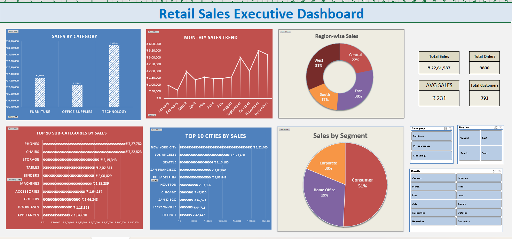
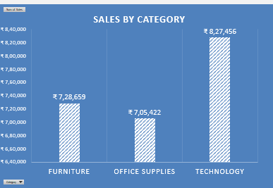

# Retail Sales Analytics & Executive Dashboard

## Project Overview

This project analyzes retail sales data to uncover key business insights, identify sales trends, and understand customer purchasing patterns.

The project combines **Python-based Exploratory Data Analysis (EDA)** and an **interactive Excel Executive Dashboard** to analyze sales performance across product categories, sub-categories, geographical regions, customer segments, and time periods.

The analysis helps businesses identify revenue drivers, evaluate market performance, understand customer purchasing behavior, and make data-driven business decisions.

## Business Objectives

- Analyze overall sales performance and distribution.
- Identify the highest revenue-generating product categories and sub-categories.
- Evaluate regional, state-wise, and city-wise sales performance.
- Understand customer segment purchasing patterns.
- Analyze daily and monthly sales trends.
- Identify high-performing and low-performing markets.
- Develop an interactive executive dashboard for sales monitoring.
- Provide actionable business recommendations based on data.

## Dataset Description

**Dataset:** Sample Superstore Sales Dataset

The dataset contains retail order and sales information.

### Key Columns

| Category | Columns |
|---|---|
| Order Details | Row ID, Order ID, Order Date, Ship Date |
| Shipping | Ship Mode |
| Customer | Customer ID, Customer Name, Segment |
| Geography | Country, City, State, Postal Code, Region |
| Product | Product ID, Category, Sub-Category, Product Name |
| Sales | Sales, Month, Day Name |

## Tools & Technologies

- **Python** – Data analysis and processing
- **Pandas** – Data manipulation and cleaning
- **NumPy** – Numerical operations
- **Matplotlib** – Data visualisation
- **Seaborn** – Statistical data visualisation
- **Microsoft Excel** – Interactive dashboard development
- **PivotTables** – Data summarisation
- **PivotCharts** – Interactive data visualisation
- **Excel Slicers** – Dynamic data filtering
- **Jupyter Notebook** – Interactive analysis environment

## Project Workflow

### 1. Data Understanding

- Loaded the dataset using Pandas.
- Inspected dataset dimensions, columns, and data types.
- Examined numerical and categorical summaries.
- Identified important business attributes for analysis.

### 2. Data Cleaning & Preprocessing

- Checked missing values.
- Identified duplicate records.
- Validated data types.
- Converted Order Date and Ship Date into datetime format.
- Investigated missing Postal Code values and handled them appropriately.
- Validated sales values.
- Prepared the cleaned dataset for exploratory analysis.

### 3. Exploratory Data Analysis (EDA)

Performed exploratory analysis to understand sales performance and customer purchasing patterns.

- Analyzed sales distribution.
- Examined category and sub-category performance.
- Compared sales across regions, states, and cities.
- Analyzed customer segment performance.
- Investigated daily and monthly sales trends.
- Identified top-performing and low-performing markets.

### 4. Data Visualisation

Created visualisations using Matplotlib and Seaborn to identify patterns, compare business performance, and communicate key findings.

### 5. Excel Executive Dashboard Development

Developed an interactive **Retail Sales Executive Dashboard** using Microsoft Excel.

The cleaned sales dataset was imported into Excel and used to create PivotTables, PivotCharts, KPI cards, and interactive slicers.

#### Key Performance Indicators (KPIs)

| KPI | Value |
|---|---:|
| Total Sales | ₹22,61,537 |
| Total Orders | 9,800 |
| Total Customers | 793 |
| Average Sales | ₹231 |

#### Dashboard Visualisations

1. **Sales by Category** – Compared revenue across Furniture, Office Supplies, and Technology.
2. **Monthly Sales Trend** – Analyzed monthly sales performance from January to December.
3. **Region-wise Sales** – Compared sales contributions across four geographical regions.
4. **Top 10 Sub-Categories by Sales** – Identified the highest revenue-generating sub-categories.
5. **Top 10 Cities by Sales** – Highlighted the top-performing cities.
6. **Sales by Segment** – Compared Consumer, Corporate, and Home Office segments.

#### Interactive Dashboard Features

Implemented Excel slicers to enable dynamic filtering across dashboard visualisations.

- **Category Slicer** – Filter sales by product category.
- **Region Slicer** – Filter sales by geographical region.
- **Month Slicer** – Analyze sales performance for selected months.

All slicers were connected to the relevant PivotTables and PivotCharts to provide an interactive dashboard experience.

---

## Dashboard Preview

### Retail Sales Executive Dashboard



**Excel Dashboard:** [View / Download Retail_Sales_Dashboard_final.xlsx](datasets/Retail_Sales_Dashboard_final.xlsx)

---

## Visualisations & Business Insights

This section presents individual visualisations created during Python-based Exploratory Data Analysis and sales analysis.

### 1. Day-Wise Sales Analysis


### 2. Monthly Sales Trend



### 3. Region vs Category Sales


### 4. Region-Wise Sales Analysis


### 5. Sales by Category


### 6. Sales Distribution


### 7. Segment vs Category Analysis


### 8. Segment-Wise Sales Analysis


### 9. Top 10 Cities by Sales


### 10. Sub-Category-Wise Sales Analysis


### 11. Top 5 and Bottom 5 States by Sales


---

## Key Business Insights

1. **Category Performance:** Technology is the highest revenue-generating product category and serves as a key business revenue driver.

2. **Sub-Category Performance:** Phones, Chairs, and Storage are the top-performing sub-categories, contributing significantly to overall sales.

3. **Regional Performance:** The West and East regions generate the highest sales revenue, while the South region has comparatively lower sales performance.

4. **Geographical Performance:** California and New York are the strongest markets, whereas states such as North Dakota and Wyoming have comparatively lower sales.

5. **Customer Segment Performance:** Consumer customers contribute the largest share of sales compared to Corporate and Home Office segments.

6. **Seasonal Sales Trends:** Sales peak during November and December, indicating strong seasonal demand during the year-end period.

7. **Daily Sales Trends:** Tuesday and Saturday generate the highest sales revenue, making them potential opportunities for promotional campaigns.

8. **City Performance:** New York City and Los Angeles are the highest-performing cities and contribute significantly to overall sales.

## Business Recommendations

- Maintain sufficient inventory for high-performing product categories.
- Focus on top-performing sub-categories such as Phones, Chairs, and Storage.
- Study successful regional sales strategies and investigate lower-performing regions.
- Explore opportunities to improve sales in lower-performing states.
- Develop targeted marketing campaigns for the Consumer segment.
- Prepare inventory and promotional campaigns ahead of year-end seasonal demand.
- Consider targeted promotions on high-performing sales days.
- Strengthen customer engagement in high-performing cities.

## Conclusion

This project combines Python-based Exploratory Data Analysis and an interactive Excel Executive Dashboard to analyze retail sales performance and uncover meaningful business insights.

Technology was identified as the highest revenue-generating category, while the West region and Consumer segment contributed significantly to overall sales. Seasonal patterns were also observed during November and December.

Python-based analysis helped identify important sales patterns, while the Excel Executive Dashboard provides an interactive way to monitor key performance indicators, compare sales across different business dimensions, and explore performance using dynamic slicers.

Overall, this project demonstrates practical skills in data cleaning, exploratory data analysis, data visualisation, Excel dashboard development, business insights, and data-driven decision-making.

## Project Structure

```text
Retail-Sales-Exploratory-Data-Analysis(EDA)/
│
├── datasets/
│   ├── cleaned_superstore.csv
│   ├── Retail_Sales_Dashboard_final.xlsx
│   └── supermarket.csv
│
├── notebooks/
│   ├── Retail_Sales_Data_Cleaning.ipynb
│   └── Retail_Sales_EDA.ipynb
│
├── visuals/
│   ├── dashboard.png
│   ├── Day-Wise Sales Analysis.png
│   ├── Monthly Sales Trend.png
│   ├── Monthly_Sales_Trend.png
│   ├── Region Vs Category Sales.png
│   ├── Region Wise Sales Analysis.png
│   ├── Region-wise_Sales.png
│   ├── Sales_by_Category.png
│   ├── Sales_by_Segment.png
│   ├── sales_distribution.png
│   ├── Segment Vs Category.png
│   ├── Segment Wise Sales Analysis.png
│   ├── Sub-Category Wise Sales Analysis.png
│   ├── Top 10 Cities by Sales.png
│   ├── Top(5) and Bottom(5) States by Sales.png
│   ├── Top_10_Sales_By_Cites.png
│   └── Top_10_Sales_by_Sub-Category.png
│
└── Readme.md
```

## How to Run This Project

1. Clone or download this repository.
2. Install the required Python libraries.
3. Open Jupyter Notebook.
4. Navigate to the `notebooks` folder.
5. Open `Retail_Sales_Data_Cleaning.ipynb` to understand the data cleaning and preprocessing process.
6. Open `Retail_Sales_EDA.ipynb` to explore the sales analysis and visualisations.
7. Run the notebook cells to reproduce the analysis.
8. Open `datasets/Retail_Sales_Dashboard_final.xlsx` using Microsoft Excel to explore the executive dashboard.
9. Use the Category, Region, and Month slicers to interactively filter the dashboard.

### Install Dependencies

```bash
pip install pandas numpy matplotlib seaborn jupyter
```

## Project Limitations

- The analysis focuses on sales revenue rather than profitability.
- The dataset does not contain a Profit column, so profit-related conclusions cannot be established.
- Lower sales figures alone do not establish market growth potential.
- The dashboard is based on historical sales data and does not provide real-time sales updates.
- Dashboard insights are limited to the available dataset and its underlying attributes.

---

**Project Category:** Data Analytics | Exploratory Data Analysis | Retail Analytics | Excel Executive Dashboard

**Skills Demonstrated:** Python, Pandas, NumPy, Data Cleaning, Data Manipulation, Exploratory Data Analysis, Matplotlib, Seaborn, Data Visualisation, Microsoft Excel, PivotTables, PivotCharts, Slicers, KPI Development, Dashboard Development, Business Insights, and Data-Driven Decision Making.
