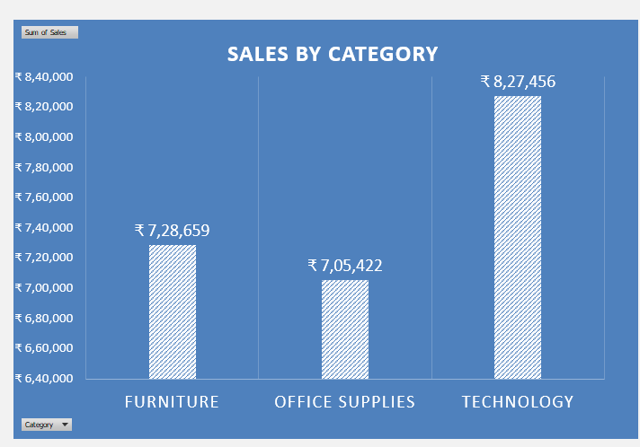
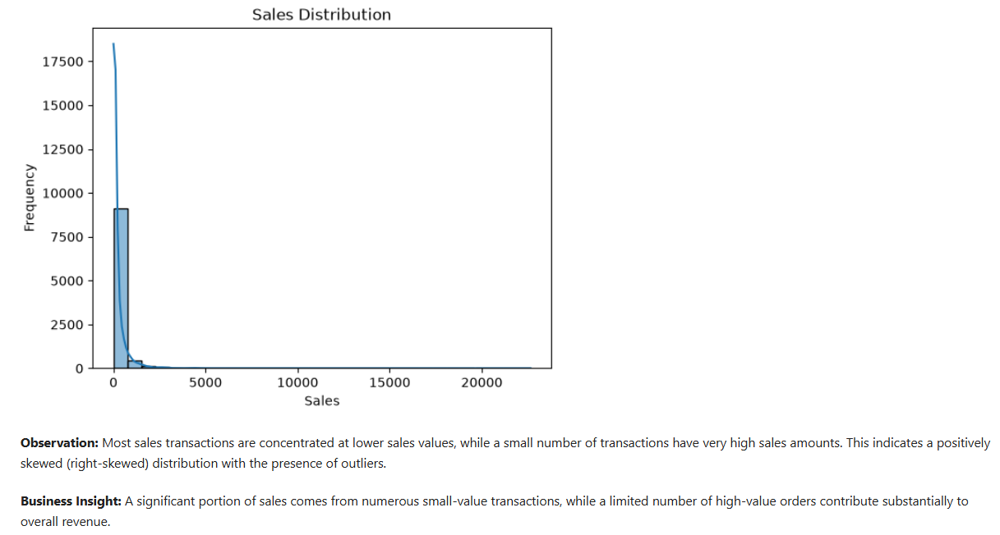

# Retail Sales Exploratory Data Analysis (EDA)

## Project Overview

This project analyzes retail sales data to uncover key business insights, identify sales trends, and understand customer purchasing patterns.

The analysis focuses on product categories, sub-categories, geographical regions, customer segments, and time-based sales performance.

The findings help businesses understand revenue drivers, identify high-performing markets, and make data-driven decisions to improve sales and marketing strategies.

## Business Objectives

- Analyze overall sales performance and distribution.
- Identify the highest revenue-generating product categories and sub-categories.
- Evaluate regional, state-wise, and city-wise sales performance.
- Understand customer segment purchasing patterns.
- Analyze daily and monthly sales trends.
- Identify high-performing and low-performing markets.
- Provide actionable business recommendations based on data.

## Dataset Description

**Dataset:** Sample Superstore Sales Dataset

The dataset contains retail order and sales information.

### Key Columns

| Category      | Columns                                          |
| ------------- | ------------------------------------------------ |
| Order Details | Row ID, Order ID, Order Date, Ship Date          |
| Shipping      | Ship Mode                                        |
| Customer      | Customer ID, Customer Name, Segment              |
| Geography     | Country, City, State, Postal Code, Region        |
| Product       | Product ID, Category, Sub-Category, Product Name |
| Sales         | Sales, Month, Day Name                           |

## Tools & Technologies

- **Python** – Data analysis and processing
- **Pandas** – Data manipulation and cleaning
- **NumPy** – Numerical operations
- **Matplotlib** – Data visualisation
- **Seaborn** – Statistical data visualisation
- **Jupyter Notebook** – Interactive analysis environment

## Project Workflow

### 1. Data Understanding

- Loaded the dataset using Pandas.
- Inspected dataset dimensions, columns, and data types.
- Examined numerical and categorical summaries.

### 2. Data Cleaning & Preprocessing

- Checked missing values.
- Identified duplicate records.
- Validated data types.
- Converted date columns where required.
- Prepared the dataset for exploratory analysis.

### 3. Exploratory Data Analysis (EDA)

- Analysed sales distribution.
- Examined category and sub-category performance.
- Compared sales across regions, states, and cities.
- Analysed customer segments.
- Investigated daily and monthly sales trends.

### 4. Data Visualisation

Created 11 visualisations using Matplotlib and Seaborn to identify patterns and communicate business findings.

---

## Visualisations & Business Insights

The following charts present the key findings from the exploratory data analysis.

### 1. Day-Wise Sales Analysis


### 2. Monthly Sales Trend


### 3. Region vs Category Sales


### 4. Region-Wise Sales Analysis


### 5. Sales by Category




### 6. Sales Distribution




### 7. Segment vs Category Analysis


### 8. Segment-Wise Sales Analysis


### 9. Top 10 Cities by Sales


### 10. Sub-Category-Wise Sales Analysis


### 11. Top 5 and Bottom 5 States by Sales

![Top 5
## Key Business Insights

1. Technology is the highest revenue-generating product category and serves as a key business revenue driver.

2. Phones, Chairs, and Storage are the top-performing sub-categories, contributing significantly to overall sales.

3. The West and East regions generate the highest sales revenue, while the South region has comparatively lower sales performance.

4. California and New York are the strongest markets, whereas states such as North Dakota and Wyoming represent potential markets for further investigation.

5. Consumer customers contribute the largest share of sales compared to Corporate and Home Office segments.

6. Sales peak during November and December, indicating strong seasonal demand during the year-end period.

7. Tuesday and Saturday generate the highest sales revenue, making them potential opportunities for promotional campaigns.

8. New York City and Los Angeles are the highest-performing cities and play a significant role in overall business sales.

## Business Recommendations

- Maintain sufficient inventory for high-performing product categories.
- Focus on top-performing sub-categories such as Phones, Chairs, and Storage.
- Study successful regional sales strategies and investigate lower-performing regions.
- Explore opportunities to improve sales in lower-performing states.
- Develop targeted marketing campaigns for the Consumer segment.
- Prepare inventory and promotional campaigns ahead of year-end seasonal demand.
- Consider targeted promotions on high-performing sales days.
- Strengthen customer engagement in high-performing cities.

## Conclusion

This project analyzed retail sales data to uncover key business insights and sales trends. Technology was identified as the highest revenue-generating category, while California and New York emerged as the top-performing markets. The Consumer segment contributed the highest sales, and strong seasonal patterns were observed during November and December. The findings can help businesses optimize inventory, improve marketing strategies, and drive revenue growth through data-driven decision-making.

## Project Structure

```text
Retail-Sales-Exploratory-Data-Analysis/
│
├── dataset/
│   ├── cleaned_superstore.csv
│   └── superstore.csv
│
├── notebooks/
│   ├── Retail_Sales_Data_Cleaning.ipynb
│   └── Retail_Sales_EDA.ipynb
│
├── visuals/
│   ├── Day-Wise Sales Analysis.png
│   ├── Monthly Sales Trend.png
│   ├── Region vs Category Sales.png
│   ├── Region Wise Sales Analysis.png
│   ├── Sales_by_Category.png
│   ├── sales_distribution.png
│   ├── Segment vs Category.png
│   ├── Segment Wise Sales Analysis.png
│   ├── Top 10 Cities by Sales.png
│   ├── Sub-Category Wise Sales Analysis.png
│   └── Top 5 and Bottom 5 States by Sales.png
│
└── README.md
```

## How to Run This Project

1. Clone or download this repository.
2. Install the required Python libraries.
3. Open Jupyter Notebook.
4. Navigate to the `notebooks` folder.
5. First open `Retail_Sales_Data_Cleaning.ipynb` to understand the data cleaning process.
6. Then open `Retail_Sales_EDA.ipynb` to explore the sales analysis and visualisations.
7. Run the notebook cells to reproduce the analysis.

### Install Dependencies

```bash
pip install pandas numpy matplotlib seaborn jupyter
```

## Project Limitations

- The analysis focuses on sales revenue rather than profitability.
- The dataset does not contain a Profit column, so profit-related conclusions cannot be established.
- Lower sales figures alone do not establish market growth potential.

---

**Project Category:** Data Analytics | Exploratory Data Analysis | Retail Analytics

**Skills Demonstrated:** Data Cleaning, Data Manipulation, Exploratory Data Analysis, Data Visualisation, Statistical Analysis, Business Insights, and Data-Driven Decision Making.
